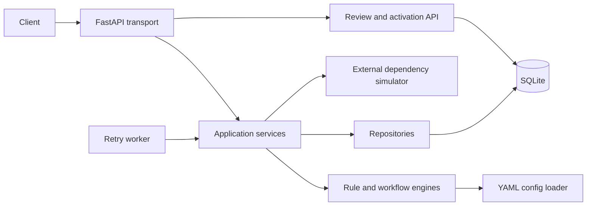

# Architecture

FlowGuard is a modular monolith. HTTP handlers validate/translate requests; application
services coordinate domain decisions and persistence; the rule and workflow engines contain
deterministic logic; adapters isolate simulated external checks. SQLite is the first durable
store. The API docs at `/docs` are the MVP interface.

## Boundaries

- `app/api`: transport, Pydantic request/response contracts, HTTP error mapping.
- `app/services`: intake, idempotency, orchestration and audit use cases.
- `app/domain`, `app/engine`: workflow semantics, legal transitions, pure rule evaluation.
- `app/adapters`: deterministic external dependency simulation.
- `app/persistence`: SQLAlchemy models, transaction boundaries and repositories.
- `app/workers`: persisted retry processing; no in-memory-only job state.
- `app/core`: settings and shared cross-cutting primitives.

## Critical invariants

- One workflow plus one idempotency key identifies at most one intake record; the database
  constraint is authoritative. A payload hash distinguishes replay from key misuse.
- A request pins the immutable configuration version selected at intake. Activation affects
  new requests only.
- Active version selection is persisted. Startup initializes only workflows without an active
  row and never overrides an operator activation with a newer discovered version.
- Rule evaluation is safe, typed, deterministic and traceable. YAML cannot execute code.
- State transitions must be legal. Persist the new state and its audit event atomically.
- Never keep a database transaction open while waiting on an external dependency.
- External operation keys are stable across retries. Retry count is bounded and fallback is
  explicit.
- Validate every stage reference and graph edge before making a config version active.
- Reviewer identity comes from the configured admin credential, never a request body.
- Review outcome, decision update, status transition and audit append share one transaction.

## Phase 3 persistence and intake

`app/persistence` owns SQLAlchemy 2 models, the SQLite engine/session factory and repository
queries. `app/services/request_intake.py` normalizes the workflow ID plus JSON data for SHA-256
idempotency, validates the selected version's structural schema, then inserts the request,
execution and initial audit event in one transaction. The scoped unique key in SQLite is the
authority during concurrent submissions. SQLite transactions acquire a write reservation at
begin (`BEGIN IMMEDIATE`) to avoid deferred read-to-write races; this serializes writers and
is appropriate only for the single-process MVP.

At startup, validated YAML definitions and input schemas are checksummed and persisted as
`WorkflowConfig` snapshots. The greatest configured version is selected only when a workflow
has no active row. Newly discovered versions are inserted inactive; an existing operator
selection survives restarts. Replacing content under an existing version/checksum fails
startup. Intake reads the persisted active row and each request stores that version.

## Phase 4 execution and retry

Execution is explicitly triggered by `POST /api/v1/requests/{id}/execute`; intake remains
unchanged. The executor loads and checksum-verifies the exact persisted config snapshot,
walks the validated stage graph, uses the Phase 2 pure rule engine, and resolves each outcome
through that config's transition table. HUMAN_TASK routes to the configured manual-review
terminal and holds. Terminal stages persist one Decision containing versioned rule traces.

Request and execution status are updated together through the lifecycle transition table, with
one ordered AuditEvent in the same short transaction. Stage movement while PROCESSING is also
audited. A lease token prevents concurrent execute triggers from claiming one execution; an
expired initial-execution lease can be recovered. External calls receive a stable operation
key and run after the claim transaction closes. A retryable error atomically stores a RetryJob
and transitions to RETRY_WAIT. A one-shot worker claims due/expired jobs with a durable lease,
then calls the provider outside the transaction. Permanent failures and exhausted retries
take the configured EXTERNAL_CALL `FAILURE` transition.

The max-attempts setting includes the first provider call. Delay grows exponentially and is
capped. The simulator reads server-side environment configuration; request data cannot select
a failure mode. The MVP is a single-worker design without exactly-once provider guarantees.

## Phase 5 audit, explanation, review and activation

The audit API returns actual append-only events ordered by sequence; it never reconstructs
history from current status. Event stage values come from persisted details, while config
version comes from the request's immutable pin. Legacy events without stage details return a
null stage. Explanation reads persisted traces, stage results, external attempts and decision
metadata; nonfinal requests remain pending and rules are never re-evaluated after activation.

Review queue reads and privileged writes require `X-Admin-Token`. A configured demo token maps
to fixed actor `demo-admin`; client-provided reviewer identity is ignored. Resolution uses one
short SQLite transaction to update request/execution, update the held unique Decision, and
append `REVIEW_RESOLVED`. Identical action/reason replay is safe; a conflicting final action
returns 409. SQLite `BEGIN IMMEDIATE` serializes concurrent reviewer actions.

Activation validates snapshot checksum, workflow graph and input schema, then switches the
active marker and inserts an `AdminAuditEvent` in one transaction. The partial unique index
allows at most one active version per workflow. Re-activating the current version is a no-op.
Only newly accepted requests see the selected version; existing requests retain their pin.

## Configuration lifecycle

Load YAML into typed models, validate local expressions and graph-wide references, then
persist an immutable version and switch the active pointer in one transaction. Requests
capture that version ID. A rule change creates a new version; historical versions remain
available for replay and explanation.

## Failure paths

Invalid input/configuration fails before workflow execution. A repeated key with different
canonical data returns conflict. Rule rejection and manual review are terminal or waiting
business outcomes, not infrastructure exceptions. Dependency timeout/failure creates a
durable bounded retry; exhaustion follows configured fallback. Unexpected exceptions are
recorded as technical failures without losing the audit trail.

## Scaling considerations

SQLite and a single retry worker suit the hackathon MVP. SQLite write serialization and
single-worker retry claiming limit throughput. For higher volume, move persistence to a
transactional server database and introduce leased/claimed jobs with idempotent consumers;
preserve the same repository and application contracts. Do not add distributed components
before measurements show a need.
