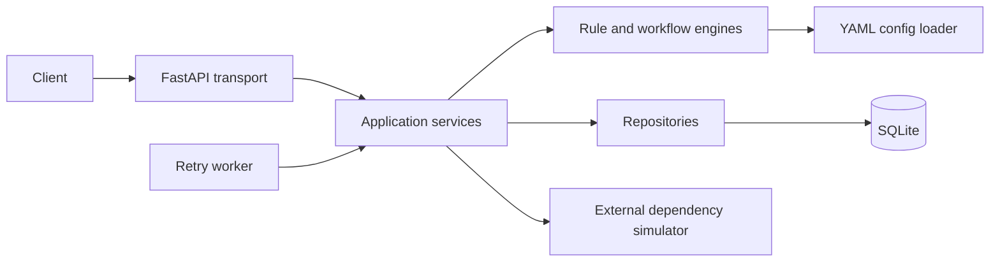

# Architecture

FlowGuard is a modular monolith. HTTP handlers validate/translate requests; application
services coordinate domain decisions and persistence; the rule and workflow engines contain
deterministic logic; adapters isolate simulated external checks. SQLite is the first durable
store. The API docs at `/docs` are the MVP interface.

## Boundaries

- `app/api`: transport, Pydantic request/response contracts, HTTP error mapping.
- `app/services`: intake, idempotency, orchestration and audit use cases.
- `app/domain`, `app/engine`: workflow semantics, legal transitions, pure rule evaluation.
- `app/adapters`: deterministic external dependency simulation.
- `app/persistence`: SQLAlchemy models, transaction boundaries and repositories.
- `app/workers`: persisted retry processing; no in-memory-only job state.
- `app/core`: settings and shared cross-cutting primitives.

## Critical invariants

- One workflow plus one idempotency key identifies at most one intake record; the database
  constraint is authoritative. A payload hash distinguishes replay from key misuse.
- A request pins the immutable configuration version selected at intake. Activation affects
  new requests only.
- Rule evaluation is safe, typed, deterministic and traceable. YAML cannot execute code.
- State transitions must be legal. Persist the new state and its audit event atomically.
- Never keep a database transaction open while waiting on an external dependency.
- External operation keys are stable across retries. Retry count is bounded and fallback is
  explicit.
- Validate every stage reference and graph edge before making a config version active.

## Phase 3 persistence and intake

`app/persistence` owns SQLAlchemy 2 models, the SQLite engine/session factory and repository
queries. `app/services/request_intake.py` normalizes the workflow ID plus JSON data for SHA-256
idempotency, validates the selected version's structural schema, then inserts the request,
execution and initial audit event in one transaction. The scoped unique key in SQLite is the
authority during concurrent submissions. SQLite transactions acquire a write reservation at
begin (`BEGIN IMMEDIATE`) to avoid deferred read-to-write races; this serializes writers and
is appropriate only for the single-process MVP.

At startup, the existing validated YAML definitions are combined with versioned input schema
files, checksummed and persisted as `WorkflowConfig` snapshots. The greatest configured
version is active per workflow until explicit activation is implemented. Replacing content
under an existing version/checksum fails startup. A request stores the selected version and
does not trigger stage execution in Phase 3.

## Configuration lifecycle

Load YAML into typed models, validate local expressions and graph-wide references, then
persist an immutable version and switch the active pointer in one transaction. Requests
capture that version ID. A rule change creates a new version; historical versions remain
available for replay and explanation.

## Failure paths

Invalid input/configuration fails before workflow execution. A repeated key with different
canonical data returns conflict. Rule rejection and manual review are terminal or waiting
business outcomes, not infrastructure exceptions. Dependency timeout/failure creates a
durable bounded retry; exhaustion follows configured fallback. Unexpected exceptions are
recorded as technical failures without losing the audit trail.

## Scaling considerations

SQLite and a single retry worker suit the hackathon MVP. SQLite write serialization and
single-worker retry claiming limit throughput. For higher volume, move persistence to a
transactional server database and introduce leased/claimed jobs with idempotent consumers;
preserve the same repository and application contracts. Do not add distributed components
before measurements show a need.
