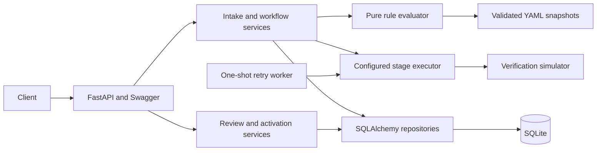
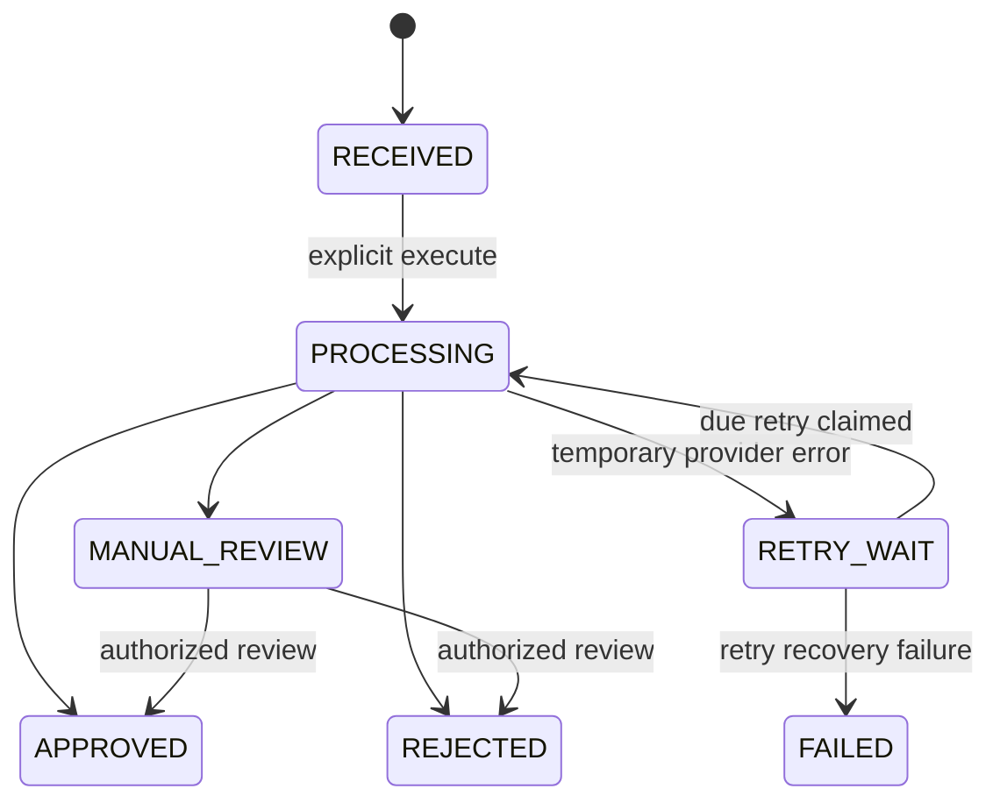

# FlowGuard — Resilient Configurable Workflow Decision Platform

## 1. Objective and problem interpretation

FlowGuard is a small, configurable platform for accepting structured workflow requests,
applying versioned business rules, invoking modeled external checks, and preserving the
result and its history. The design emphasizes deterministic decisions, idempotent intake,
auditable state changes, bounded recovery, and rule changes that do not rewrite in-flight
work. FastAPI Swagger UI is the operator interface for this MVP.

## 2. Requirements addressed

The implementation provides a Python 3.11+ modular monolith using FastAPI, Pydantic v2,
SQLAlchemy 2, SQLite, PyYAML, pytest and HTTPX. It includes structured request validation,
YAML workflow/rule versions, explicit execution, lifecycle persistence, audit and explanation
APIs, manual review, active-version management and a persisted retry worker. See
[`REQUIREMENTS_TRACEABILITY.md`](REQUIREMENTS_TRACEABILITY.md) for requirement-by-requirement
code, test and limitation mapping.

## 3. High-level design



Transport schemas/error mapping live in `app/api`. Application use cases live in
`app/services`; pure rule/config and lifecycle logic is in `app/engine` and `app/domain`.
Provider behavior is behind `app/adapters`. SQLAlchemy models/session handling is in
`app/persistence`, and `app/workers` contains the retry CLI.

## 4. Low-level design and request lifecycle

`POST /api/v1/requests` validates the selected active version's input schema, checks the
idempotency scope, and atomically writes the request, initial execution and first audit event.
It does not start workflow execution. `POST /api/v1/requests/{id}/execute` claims an execution
lease and walks the request's pinned configuration. Rule and stage results persist as
execution context; status changes, decision writes and their audit events are committed in
short transactions. External calls occur after the transaction closes.



`FAILED` is a technical terminal state. `MANUAL_REVIEW` is pending until a reviewer resolves
it. A final execution replay returns stored state and does not add a second decision or audit
event.

## 5. Persistence and atomicity

SQLite stores `WorkflowRequest`, `WorkflowExecution`, `AuditEvent`, `Decision`, `RetryJob`,
immutable `WorkflowConfig` snapshots and administrative activation events. Database
constraints enforce the scoped idempotency key, one execution and decision per request,
ordered unique audit sequence, retry operation keys and at most one active config version per
workflow. SQLite foreign keys are enabled. `BEGIN IMMEDIATE` serializes local write
transactions.

Intake, workflow state transitions, review resolution and config activation pair their local
state changes and audit records in one transaction. Failure-injection tests verify rollback
of review and activation changes when commit fails. The database cannot roll back an external
side effect. Provider calls therefore use stable operation keys, but exactly-once external
execution is not claimed.

## 6. Versioned YAML workflow and rules

Definitions in `configs/workflows/` specify `workflow_id`, integer `version`, `entry_stage`,
`rule_sets`, typed `stages` and explicit `transitions`. Structural input schemas are separate
versioned files in `configs/input_schemas/`. The loader validates types, rule references,
stage references, transition outcomes, reachability and acyclic graphs before snapshots are
activated. Persisted snapshots carry a checksum; changing content under the same workflow
version is rejected.

Rule conditions support `eq`, `ne`, `gt`, `gte`, `lt`, `lte`, `in`, `not_in`, `exists` and
nested `all`/`any` groups over dot-separated input paths. Evaluation uses explicit operator
mapping, never `eval` or `exec`. Missing values produce a failed trace; incompatible types
raise an evaluation error. Rules retain declaration order and `REJECT` takes precedence over
`MANUAL_REVIEW` when multiple rules fail.

## 7. Example workflows and decisions

- `loan_approval_v1`: age at least 18, monthly income at least 30,000, credit score at least
  700, followed by identity verification. A score of 710 passes eligibility; with a successful
  simulator result, it is approved.
- `loan_approval_v2`: same graph, but credit score must be at least 720. Score 710 enters
  manual review.
- `vendor_approval_v1`: configured registration, compliance and turnover rules followed by
  external verification. Registration must equal `VALID`; tax clearance and sanctions
  clearance must both be true; annual turnover must be at least 500,000. Compliance and
  turnover failures route to manual review; invalid registration is rejected.

Each stored rule trace has the rule ID, field/expression reference, operator, actual and
expected values, pass result, configured failure action, reason and config version. For
example, a score-710 v2 trace for `minimum_credit_score` has expected value 720, actual value
710, `passed: false`, and `failure_action: MANUAL_REVIEW`. The explanation endpoint reads the
stored trace; it does not reevaluate the request under a newer version. More scenarios are in
[`DECISION_EXAMPLES.md`](DECISION_EXAMPLES.md).

## 8. Idempotency and duplicates

`Idempotency-Key` is required. The uniqueness scope is `(workflow_id, idempotency_key)` and is
enforced by SQLite. A canonical JSON hash covers workflow ID and request data. Equivalent
replays return the original request, including its original config version; a changed payload
under the same key returns HTTP 409. Concurrent submission tests verify the database
constraint remains authoritative.

## 9. External dependency and retries

The typed verification simulator supports success, temporary failure, fail-then-recover and
permanent failure scenarios selected by server environment variables, not request fields.
Retry jobs persist attempt count, due time, stable operation key and claim lease. The first
provider call counts toward `FLOWGUARD_RETRY_MAX_ATTEMPTS`; delays use capped exponential
backoff. Run one due-work pass with:

```powershell
.venv\Scripts\python.exe -m app.workers.retry_worker --once
```

Worker restart and expired-lease recovery are integration tested. A crash after provider
success but before the local result commits can repeat that call. Stable operation keys only
deduplicate effects if the provider honors them. There is no lease heartbeat or distributed
exactly-once guarantee.

## 10. Audit, explainability and manual review

`GET /api/v1/requests/{id}/audit` returns stored events in sequence order without synthesizing
history. `GET /api/v1/requests/{id}/explanation` combines the persisted outcome, rule traces,
stage results and provider attempts. Nonfinal requests are marked pending and have no final
outcome. Older audit entries can have no stage reference.

The review queue and privileged writes require `X-Admin-Token`. A configured demo token maps
to the fixed actor `demo-admin`; the client cannot select the reviewer identity. Resolution
requires `APPROVE` or `REJECT` plus a reason. The existing held decision is updated in place,
retaining its evidence. Request/execution status, decision and audit event are committed
atomically. Identical resolution replays are safe; conflicting resolutions return 409.

## 11. Configuration activation and pinning

On the first database initialization, the highest validated version is selected once. Later
starts preserve the persisted active selection; newly discovered versions are stored inactive
until explicitly activated. `POST /api/v1/admin/workflows/activate` validates the selected
snapshot and atomically changes the active marker and records an administrative audit event.
Requests accepted earlier continue to use their pinned version. The integration demo
activates loan v1, submits a 710 score request, activates v2, submits another request, and
verifies outcomes `APPROVED` and `MANUAL_REVIEW` while the first request remains on v1.

## 12. Security assumptions

The admin credential is a shared demo secret supplied through `FLOWGUARD_ADMIN_TOKEN`; it is
not included in `.env.example` as a value and must not be committed. Missing credentials are
rejected, incorrect credentials are forbidden, and an unset server token disables protected
operations with HTTP 503. Admin authentication is not production identity, role management,
or user-level access control. Audit and explanation endpoints are request-ID scoped but
unauthenticated in this MVP. The application does not return whole request payloads from those
endpoints. Use TLS and a real identity/secret-management design before production deployment.

## 13. Test evidence

Verified in the project `.venv` on Python 3.11.9:

- `.venv\Scripts\python.exe -m pytest -q` — **91 passed, 1 warning**.
- `.venv\Scripts\python.exe -m compileall -q app` — passed.
- `git diff --check` — passed; Git reported line-ending normalization notices only.
- Editable install `.venv\Scripts\python.exe -m pip install -e ".[dev]"` — passed.
- Isolated FastAPI smoke check verified `/health`, `/docs` and `/openapi.json` (see final
  `TEST_RESULTS.md` entry).

The sole test warning is Starlette's upstream TestClient/httpx deprecation. Test databases are
in-memory or per-test temporary files; the developer's persistent `flowguard.db` is not a
test fixture. See [`TEST_RESULTS.md`](../project_management/TEST_RESULTS.md) for phase-by-phase
evidence and [`REQUIREMENTS_TRACEABILITY.md`](REQUIREMENTS_TRACEABILITY.md) for the full
rubric mapping.

## 14. Trade-offs, assumptions and scaling

SQLite and a synchronous modular monolith keep setup and local atomic transactions simple but
serialize writes and limit throughput. The retry CLI is one-shot and the MVP assumes one
worker. YAML avoids executable business logic but rejects cycles and arbitrary workflow code.
Alembic migrations, distributed queue infrastructure, a React frontend and production
identity integration are deferred. These choices and their consequences are detailed in
[`TRADEOFFS.md`](TRADEOFFS.md).

For higher volume, measure first, then consider a server database with migrations, multiple
workers using durable claims, provider idempotency contracts, observability, authorization
roles and a retention policy. Preserve request version pins and the atomic audit/state
contract during any migration.

## 15. Setup and demonstration

Use the Windows PowerShell [Quick Start](../README.md#quick-start-windows-powershell), then
open `http://127.0.0.1:8000/docs`. The README contains copyable examples for request intake,
execution, retry processing, review resolution and switching versions. Do not point a demo or
test at a database containing user data.
