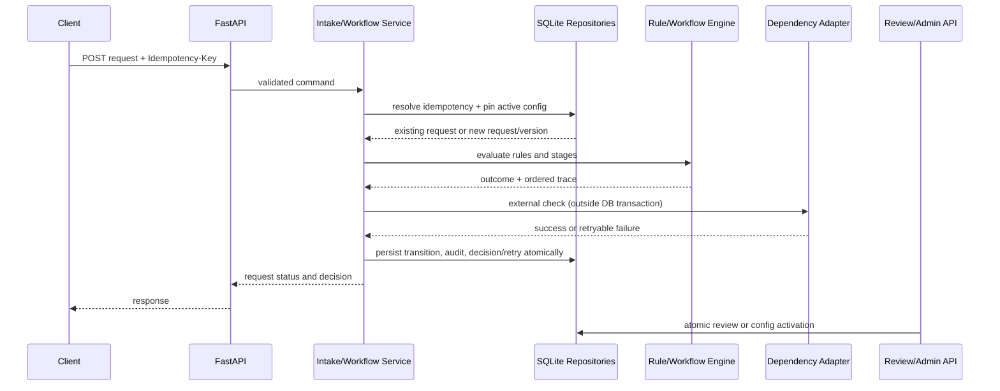

# High-Level Design

## Runtime flow (target architecture)

Phase 4 implements explicit execution from the persisted `RECEIVED` state. Each rule/stage
transition commits its execution/request state and audit event before the next stage. Provider
calls are outside DB transactions. Retryable provider errors persist a due job and return the
request as `RETRY_WAIT` until the worker claims it.

Phase 5 adds ordered audit and persisted explanation reads, admin-protected manual review,
and database-backed version activation. Review state, decision and audit commit atomically.
Activation writes an admin audit record and changes only the active marker; requests continue
to use their pinned snapshot.

## Data records (planned)

Workflow configuration/version, request, execution, decision, audit event, retry job and,
if needed, external operation record. Relational constraints enforce idempotency and useful
referential integrity. Audit events record actor/source, transition, timestamp, config
version and relevant trace/metadata.

## State and decision outcomes

Business outcomes include approved/success, rejected, and manual review. Operational states
include in progress, retry waiting, technical failure, and terminal completion. The workflow
state machine explicitly defines allowed edges; API handlers do not mutate state directly.

## API surface (target)

`POST /api/v1/requests`, request status/audit/explanation reads, workflow list/version reads,
admin activation, review queue/resolve, retry processing, and `GET /health`. FastAPI Swagger
UI is the initial operator/client interface.

Phase 5 also provides audit/explanation reads, review listing/resolution and version activation.
The intake contracts remain 202 for new requests and 200 for equivalent replay. The
execute endpoint returns current persisted state; repeated triggers do not duplicate decisions
or external effects while a claim is live or after completion.

## Implemented lifecycle

`RECEIVED -> PROCESSING`; `PROCESSING -> APPROVED | REJECTED | MANUAL_REVIEW | RETRY_WAIT |
FAILED`; `RETRY_WAIT -> PROCESSING | FAILED`; authorized review allows
`MANUAL_REVIEW -> APPROVED | REJECTED`.
Request and execution rows share one canonical status. State and audit sequence changes commit
atomically. Intermediate stage movements are audited with `PROCESSING` as both old and new
state.

## Reliability boundary

The MVP assumes one application/retry worker against SQLite. The current engine acquires
SQLite's write reservation at transaction start, so writes serialize. Retry and execution
leases recover after expiry, but a crash after provider success and before local commit can
repeat the call. Stable operation keys reduce that risk only if the dependency honors them;
true exactly-once behavior is not promised.
