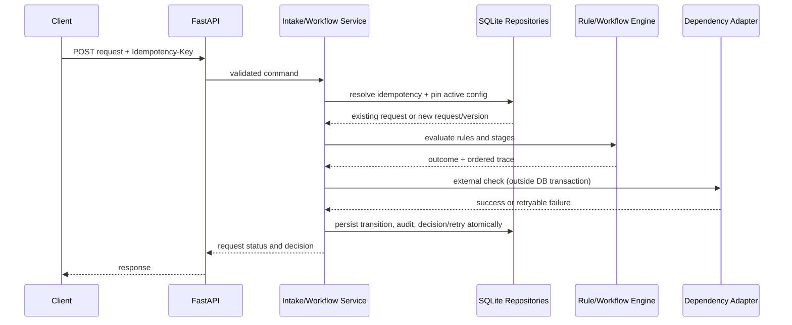

# High-Level Design

## Runtime flow (target architecture)

The complete sequence is the intended platform. Phase 3 currently implements the intake
through persistence and returns at `RECEIVED`; evaluation and external stages are not run.
Later implementation may split stage execution into multiple short transactions around
external calls.

## Data records (planned)

Workflow configuration/version, request, execution, decision, audit event, retry job and,
if needed, external operation record. Relational constraints enforce idempotency and useful
referential integrity. Audit events record actor/source, transition, timestamp, config
version and relevant trace/metadata.

## State and decision outcomes

Business outcomes include approved/success, rejected, and manual review. Operational states
include in progress, retry waiting, technical failure, and terminal completion. The workflow
state machine explicitly defines allowed edges; API handlers do not mutate state directly.

## API surface (target)

`POST /api/v1/requests`, request status/audit/explanation reads, workflow list/version reads,
admin activation, review queue/resolve, retry processing, and `GET /health`. FastAPI Swagger
UI is the initial operator/client interface.

Phase 3 implements request creation and status, workflow list, workflow versions, and health.
The new request and an equivalent idempotent replay return HTTP 202 and 200 respectively;
replay responses carry `Idempotency-Replayed: true`. Request status remains `RECEIVED`, with
no decision until later workflow execution.

## Reliability boundary

The MVP assumes one application/retry worker against SQLite. The current engine acquires
SQLite's write reservation at transaction start, so writes serialize. Persisted retries survive
process restart, but a crash after an external side effect and before local commit can repeat
the call. Stable operation keys and an idempotent simulator reduce that risk; true exactly
once behavior requires cooperation from the dependency.
